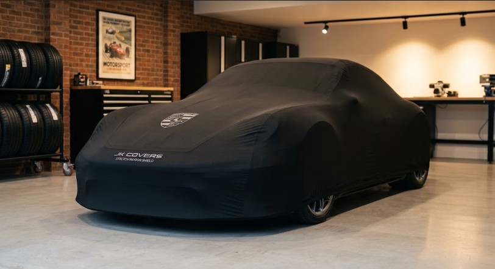

# Indoor Stretch Car Covers for Sports Cars: Why Three Sizes Is Enough

Brands entering the indoor cover category usually start from the same assumption: sports car owners want a tailored cover, so the range needs a tailored size for every model. That is how a simple product becomes a forty-SKU inventory problem with no depth on any single size.

A stretch cover breaks that logic, because the fabric does part of the fitting.

## What the fabric has to do

The cover is a brushed polyester-spandex knit. The property that matters is not thickness but multidirectional stretch — around 10% — combined with recovery, so the cover pulls taut over a curve and returns when removed.

Two consequences follow. The inside has to be a brushed fleece face, since that is the layer touching paint and it must be soft enough for clear coat. And the cut is deliberately smaller than the car: a stretch cover is meant to sit under tension, not to hang.

## Three sizes, not thirty

Sizing is built around three body groups rather than individual models.

| Size | Class | Static cut (L × W × H) | Stretched length |
|---|---|---|---|
| S | Compact sports | 3,900 × 1,750 × 1,150 mm | up to 4,290 mm |
| M | Mid-size GT and supercar | 4,300 × 1,820 × 1,180 mm | up to 4,730 mm |
| L | Grand tourer and muscle | 4,600 × 1,880 × 1,220 mm | up to 5,060 mm |

Size S targets short-wheelbase, low-roof coupés: Elise, Exige, Evora, Emira, Cayman, Boxster, TT. Size M covers the mainstream sports and supercar band: 911, R8, Corvette C7 and C8, F-Type. Size L takes longer, wider GTs and muscle coupés: Mustang, Challenger, M4, DB11, AMG GT.

The gaps between classes are deliberate. A cover cut to the middle of a class stretches in both directions; one cut to a single model has no margin either way.

## Graphics that survive being stretched

Printing is the part buyers underestimate. A standard plastisol or water-based print on a stretch knit crazes and lifts at the edges once the cover is fitted, because the ink does not elongate with the fabric.

Two methods work: a high-stretch TPU heat transfer for detailed artwork, and a stretchable silicone print for bold shapes and reflective trim. Both are applied so the graphic sits in the same elongation range as the fabric beneath it.

## Mirror pockets are the real fit problem

Mirror position varies more than body size — door-mounted on one model, A-pillar-mounted on the next, and set at different heights. A pocket cut for one car distorts the cover on another.

The practical answers are a seamless profile that lets the fabric pass over the mirror, or a generous elastic pocket that tolerates the range. A tight, model-specific pocket is the wrong choice for a three-size range.

## The hem

A full elastic hem front and rear is what converts stretch into fit. It also makes the cover a sub-minute item, which matters on a car that is covered and uncovered daily.

## What to check before committing

- fit samples on real cars at both ends of each size class
- check recovery after a week under tension, not after an hour
- stretch the printed area and look for edge lift
- confirm the interior face against dark paint in sunlight

For wholesale enquiries and OEM programmes, visit autobean.en.alibaba.com or coverabc.en.made-in-china.com, and explore www.jkcovers.com and www.customfitprotection.com.
